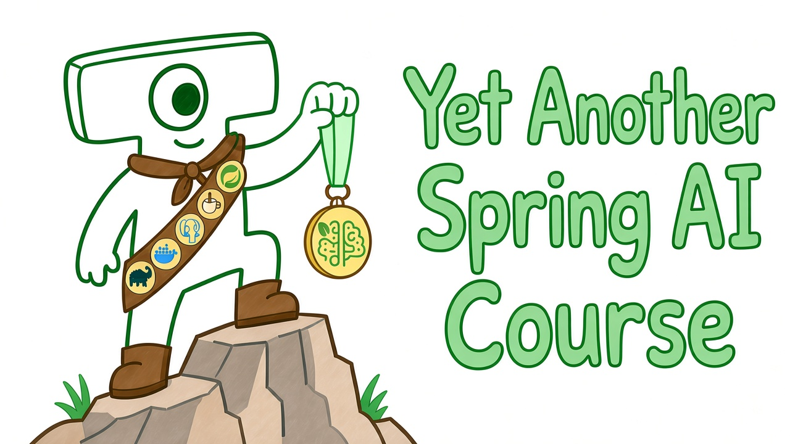

# Курс по Spring AI от [Tayviscon IO](https://github.com/tayviscon-io)

**Yet Another Spring AI Course** - это курс от компании [Tayviscon IO](https://github.com/tayviscon-io)
из серии «[Yet Another Course](https://github.com/tayviscon-io/yet-another-course)»
и входит в направление [Tayviscon Goes AI](https://github.com/tayviscon-goes-ai).

## Автор и Контрибьюторы
Данный курс развивается силами сообщества [Tayviscon IO](https://github.com/tayviscon-io).
Большое спасибо [всем](https://github.com/tayviscon-goes-ai/yet-another-spring-ai-course/graphs/contributors),
кто помогает развивать данный проект.

