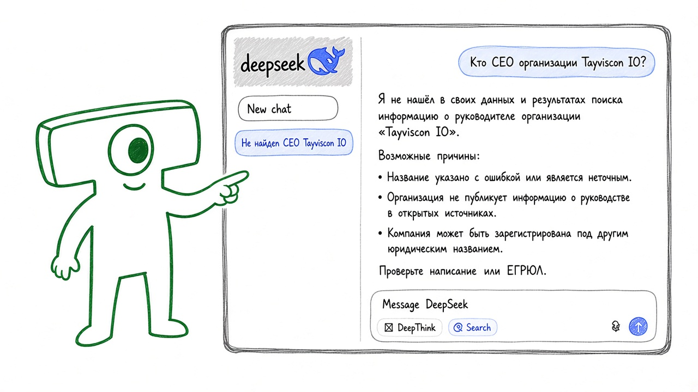

Открытые языковые модели почти ничего не знают про организацию [Tayviscon IO](https://github.com/tayviscon-io).

Спросите любую из них, кто руководит организацией, когда она появилась или какие курсы ведёт.
Как думаете, что услышите в ответ?

Чаще всего — уверенную выдумку или просто ошибку.

У вашей команды обычно та же картина: у модели нет ваших внутренних текстов
о процессах, устройстве компании или услугах, поэтому она не может уверенно
рассказать о вас клиенту.

Курс для разработчиков, которые уже пишут на Java и Spring Boot.
На этом стеке вы соберёте TayvisconGPT — Spring AI-приложение, которое отвечает
на вопросы об организации по вашей внутренней документации.
Курс входит в направление [Tayviscon Goes AI](https://github.com/tayviscon-goes-ai).
Тот же путь подойдёт, если нужен чат-бот про свою компанию или услуги.
Мы будем работать с готовыми моделями через [Spring AI](https://docs.spring.io/spring-ai/reference/) на бэкенде:
свою LLM с нуля не обучаем и полноценный фронтенд или прод-деплой здесь не строим.

К концу курса вы сможете:
- подключить языковую модель к Spring-приложению и получить осмысленный ответ;
- сохранить контекст диалога, чтобы бот не «забывал» предыдущие реплики;
- искать по документации и строить ответы на найденных фрагментах, а не на догадках модели.

Новую фичу начинаем только когда упираемся в живую проблему.
Сначала спросим бота про Tayviscon IO без документов, увидим выдумку,
потом подключим поиск по вашим текстам и починим ответ.
Дальше так же с потерей контекста диалога и с плохим поиском по документации:
сначала видим, где ломается, потом чиним.

Дальше во введении коротко опишем формат обучения и сверим предварительные знания.
Основная работа — в секции «Разработка TayvisconGPT».
