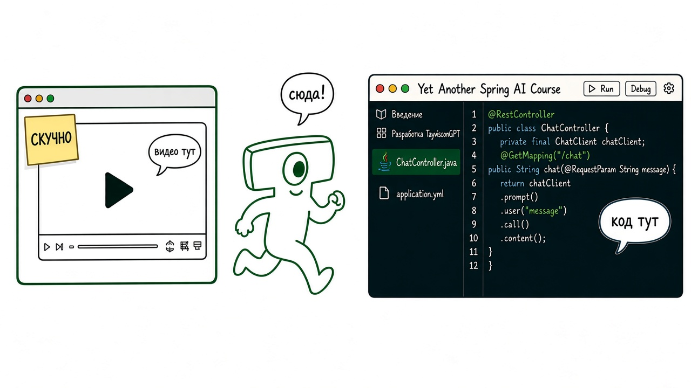
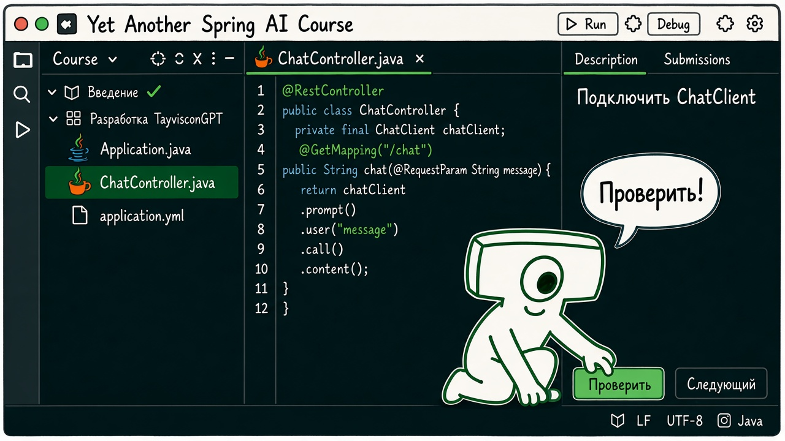

Обычный онлайн-курс часто живёт в браузере: смотрите видео, потом переключаетесь в IDE и ищете, куда вставить фрагмент.
Здесь теория и код в одном проекте. Курс реализован с помощью JetBrains Academy plugin
(его ещё называют Educational Plugin).
Установку плагина по шагам не разбираем: экраны и кнопки — в
[руководстве для ученика](https://plugins.jetbrains.com/plugin/10081-jetbrains-academy/docs/learner-start-guide.html).

Как это выглядит у вас. Слева — дерево курса: секции, уроки и шаги.
Пройденный шаг обычно зелёный, с ошибкой — красный, ещё не начатый — серый.
Справа — панель задания: текст урока, подсказки и кнопка «Проверить».
Между ними тот же редактор, запуск и отладчик, которыми вы пользуетесь каждый день.
Учебный интерфейс можно свернуть и работать с проектом как с обычным.

Теория — читаете текст (иногда со схемой или ссылкой) и идёте дальше.
Практика — пишете код в проекте; кнопка «Проверить» запускает преподавательские тесты
и сразу показывает, прошло или нет.
Иногда встретится короткий вопрос с вариантами ответа.
Вы правите живой код приложения в своей IDE.

Основная работа — сквозной проект в секции «Разработка TayvisconGPT».
Это один растущий проект, разрезанный на связанные шаги.
Решение с текущего шага переносится на следующий: ваш код не обнуляется.
Собираем чат-бот поверх языковой модели с поиском по документации и остальным функционалом курса.
Идём по такому пути: добавляем функцию, запускаем, смотрим, где ломается.
Следующий урок обычно и есть эта проблема и способ её закрыть.
Отладка, логи и поиск по коду остаются под рукой: обучение не уводит из среды разработки.

На курсе активно используются Java, Spring Boot, Docker, PostgreSQL и Ollama.
Если в этом стеке вы чувствуете себя уверенно, то можно отойти от сценария преподавателя
и глубже копать каждый отдельный шаг, сценарий или урок.
Если не очень ориентируетесь в этих технологиях — лучше идти по протоптанному пути:
смотреть разбор и пытаться вникнуть в то, что объясняет преподаватель.

Дальше сверим предварительные знания, потом перейдём к разработке TayvisconGPT.
